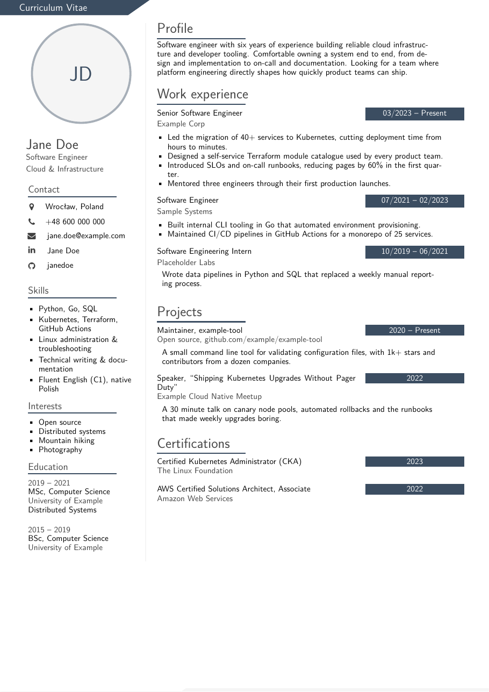
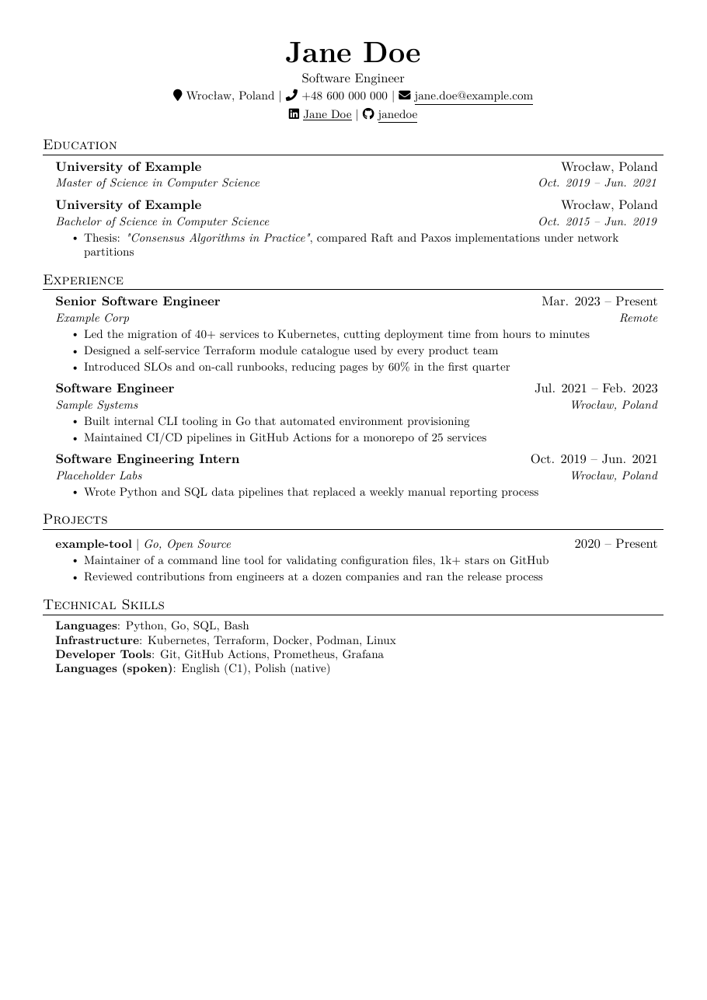
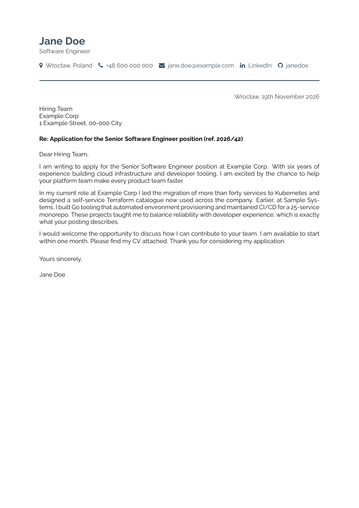
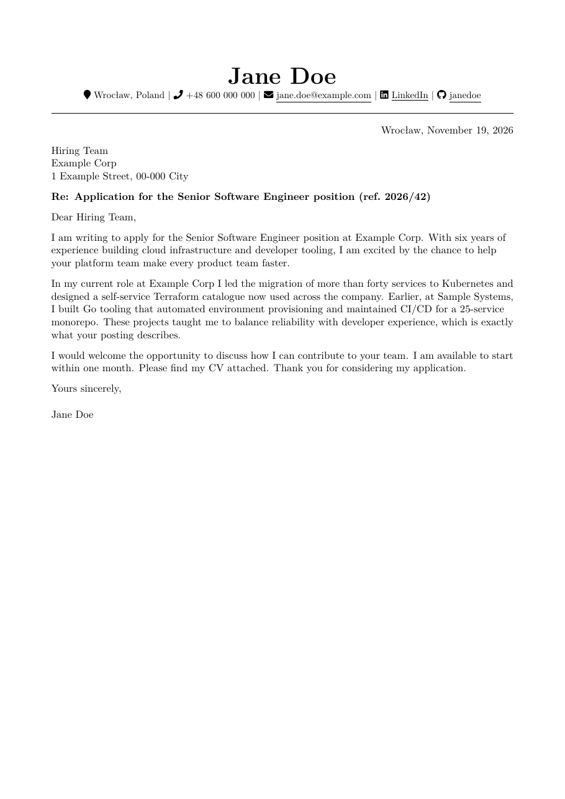

# 📄 Resume Template

A cookiecutter template for a LaTeX CV that builds inside a container. One
person, one repo. You edit a single `.tex` file, push, and GitHub Actions
publishes a fresh PDF as a release. Nobody needs a local TeX installation:
Podman (or Docker) and `make` are enough.

| Sidebar | Classic |
| ------- | ------- |
|  |  |
|  |  |

The PDFs behind these previews are in [`preview/`](preview/). They are exactly
what `make` produces right after generation with the default answers.

## Two designs

**Sidebar** is a two column layout with an accent header, a round photo (or
an initials badge if you skip the photo) and a contact/skills sidebar. It is
based on [modern-latex-cv](https://www.overleaf.com/latex/templates/modern-latex-cv/qmdwjvcrcrph)
by Philip Empl.

**Classic** is a single column layout that applicant tracking systems parse
well. It is based on [Jake's Resume](https://github.com/jakegut/resume) by
Jake Gutierrez.

Both can come with a matching cover letter and, for Polish employers, the RODO
recruitment consent clause in small print at the bottom of the page.

### Not locked to these two

These are two well known designs picked as a starting point, nothing more.
Overleaf's [CV gallery](https://www.overleaf.com/latex/templates/tagged/cv),
CTAN and GitHub have hundreds more (Awesome-CV, moderncv, AltaCV, Deedy, ...),
and the generated project is built to take any of them. Drop the template's
files into `src/`, flip one line in `latexmkrc` if it needs XeLaTeX or
LuaLaTeX, and add missing packages to the `Containerfile` by file name
(`dnf install 'tex(name.sty)'`). The container, CI and releases stay the same.

### Built for AI assistants

Every generated project ships an `AGENTS.md` describing its layout, build,
verification steps and how to swap designs, plus `CLAUDE.md` and
`.github/copilot-instructions.md` pointing at it. Claude Code, GitHub Copilot,
Codex, Cursor and friends read these automatically, so you can ask one to
tailor the CV to a job posting or port it to a different template without
explaining the setup.

## Usage

Install [cookiecutter](https://cookiecutter.readthedocs.io/) once
(`pipx install cookiecutter`, `uv tool install cookiecutter`, or
`dnf install python3-cookiecutter`), then:

```bash
cookiecutter gh:John15321/resume-template
cd <project_slug>
make            # builds the TeX Live image on first run, then build/cv.pdf
```

The first run pulls Fedora and installs TeX Live, which takes a few minutes.
Later builds take seconds. Run `make help` in the generated project for every
target, including `make watch` for rebuild-on-save. The generated README has a
step-by-step Windows guide for people who have never used a terminal.

To publish, create an empty GitHub repo, push, and every commit to `main`
updates the `latest` release with the PDF. Pushing a `v*` tag creates a
versioned release.

## Prompts

| Prompt | Purpose |
| ------ | ------- |
| `full_name` | Printed on the CV; also drives the initials badge, PDF file names and slug |
| `headline` | Job title under your name |
| `headline_secondary` | Second line under the title (sidebar only, empty hides it) |
| `email` | Contact line (validated) |
| `phone` | Contact line, empty hides it |
| `location` | City, Country. Contact line and the cover letter's date line |
| `linkedin_url` | Full profile URL, empty hides it |
| `github_username` | Empty hides it |
| `cv_style` | `sidebar` or `classic` |
| `include_photo` | Sidebar only. Shows `src/resources/photo.jpg`, or initials until you add one |
| `include_cover_letter` | Adds `src/cover-letter.tex`, built alongside the CV |
| `include_gdpr_clause` | Adds the Polish RODO consent clause |
| `paper_size` | `a4` or `letter` |
| `project_slug` | Directory/repo name, defaults to `<name>-cv` |
| `github_repo_owner` | Used for the clone URL in the generated README |

## What you get

A `Containerfile` (Fedora 45 + TeX Live with pdflatex, xelatex and lualatex,
plus latexmk), a `latexmkrc` choosing the engine, a `Makefile` wrapping small
POSIX shell scripts that auto-detect Podman or Docker, a GitHub Actions
workflow that builds and releases the PDFs, VS Code settings for LaTeX
Workshop, and the agent files described above. Mounts are relabelled (`:Z`)
so builds work on SELinux hosts like Fedora, and Git Bash on Windows is
handled too.

## Developing the template

`scripts/test-template.sh` renders every variant (both designs, with and
without photo, a "full" variant with Polish diacritics, special characters,
letter paper, cover letter and RODO clause) into `_test/`, builds each one and
checks every PDF is a single page. CI runs the same matrix on every push.

```bash
scripts/test-template.sh                  # all variants
scripts/test-template.sh --render         # render only, no container
scripts/test-template.sh classic-full     # one variant
IMAGE=my-texlive:latest scripts/test-template.sh   # reuse one prebuilt image
```

LaTeX and Jinja share `{%`, `{{` and `{#`, so the `.tex` sources keep their
preambles in `` blocks and escape user input through a small `tex()`
macro defined at the top of each file. `AGENTS.md` (and `CLAUDE.md`) at the
repo root cover these rules for coding agents working on the template.

## Credits

The CV designs are MIT licensed by their original authors (notices kept in
each `.tex` file). The build setup comes from a few CVs built for friends and
family, generalised here.
